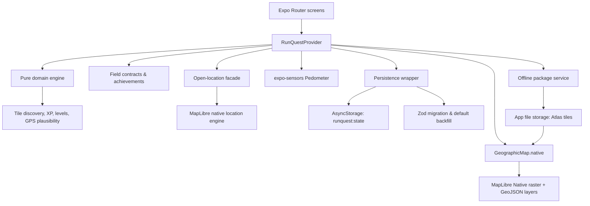

# RunQuest Architecture & Product Assessment

**Prepared by:** Manus AI  
**Assessment date:** 12 August 2026  
**Assessment scope:** Read-only review of the current RunQuest workspace, dependency surface, state model, map and offline workflows, test suite, and open-source implementation references.  
**Decision status:** **Awaiting explicit implementation approval.** No product code, configuration, dependencies, assets, or saved-game schema were modified as part of this assessment.

## Executive assessment

RunQuest has a credible and differentiated product core: a **local-first exploration game** that turns walking and running into persistent atlas discovery, while avoiding Google Maps, Google Play Services location, Firebase, and cloud-account dependence in its gameplay path. Its strongest qualities are the deterministic territory engine, versioned tile identifiers, visible progression rules, bounded in-memory collections, Zod-backed sanitisation at the persistence boundary, and a single `RunQuestProvider` that owns game state. Those choices give the app a sound base for its stated “Windows-style” compatibility promise.

The current product is **not yet ready to expand its offline-map feature without a corrective foundation change**. The most important finding is that the existing “offline Atlas pack” fetches tiles from `tile.openstreetmap.org`. The OpenStreetMap Foundation explicitly prohibits offline download and prefetch features on that public tile service, and recommends a self-hosted or provider-permitted alternative for offline maps.[3] This is both an operational reliability risk—access can be blocked—and a policy-compliance issue. The requested tile-server settings must therefore precede or be delivered together with offline-region improvements.

The app also needs more resilient local data handling before it takes on richer sensor and map experiences. Current saved state is one JSON value in `AsyncStorage`; a failed or interrupted replacement can fall back to a blank state, and an active expedition is not persisted as a recoverable work-in-progress. The architecture is otherwise well positioned to solve this without breaking `RunQuestState v1`: add a forward-only persistence envelope with verified dual snapshots, retain the legacy key as a migration source, and make any new settings strictly optional with defaults.

> **Recommendation:** Approve the proposed roadmap only as a staged programme. First correct offline-provider compliance and data durability, then add the requested interactive map, pack-management, provider-selection, and sensor-assist capabilities. This order protects saved discoveries and prevents a polished interface from masking a fragile or non-compliant offline path.

| Dimension | Current assessment | Readiness for the requested feature set |
|---|---|---|
| Product concept | Strong, differentiated, and coherent | Ready to deepen without changing the game’s identity |
| Core game engine | Deterministic and bounded | Ready; preserve public rules and tile identity format |
| Map rendering | Functional MapLibre Native foundation | Needs live camera, accurate position treatment, provider abstraction |
| Offline maps | Small proof of concept only | Needs immediate provider-policy correction, integrity manifest, selection and recovery |
| Persistence | Good validation and retry intent, weak crash recovery | Needs durability upgrade before feature growth |
| Sensor tracking | Pedometer-only, foreground-only | Suitable for capability-driven incremental assist, not universal sensor fusion |
| UX/game feel | Clear and restrained, but map moments are static | Ready for focused feedback, follow controls, and stronger expedition payoff |
| Technical debt | Contained in game modules, significant template residue around them | Remove only after the stronger regression suite is in place |

## 1. Product vision, audience, and experience fit

RunQuest is best positioned as an **Android-first, privacy-conscious urban exploration game for walkers and runners**. It is not merely an activity tracker: the recurring loop is to begin a foreground expedition, traverse real places, uncover deterministic atlas cells, receive XP and contract progress, finish the activity, and retain an on-device history. This combines the short reward cycle of a location game with the measurable record expected from a fitness utility.

The concept is especially aligned with three audiences. Casual explorers need a low-pressure reason to walk unfamiliar streets; regular runners need an additional objective that does not distort their workout; and privacy or open-source-minded users need a map experience that does not require a Google account, Firebase backend, or proprietary activity cloud. The present code meaningfully supports these claims through local state ownership, foreground-only tracking, a demo fallback, capability messaging, and visible rules rather than hidden scoring.

The product’s main experiential gap is **situational presence**. The active map is technically interactive but visually behaves like a static monitor: the current position is a fixed GeoJSON circle, the map’s camera receives only an initial view state, the accuracy of a reading is invisible, and the user cannot select the downloaded atlas pack that should be in view. Those omissions reduce confidence during a live expedition and make the primary gameplay moment feel less alive than the Home, Contract, and Report surfaces suggest.

The app should not aim to “use every sensor” as a goal in itself. Device hardware is heterogeneous: Android’s official guidance states that manufacturers are not required to include every sensor, and even devices with the same Android version can expose different hardware combinations.[6] The correct product standard is **capability-based, optional sensor assistance**: use a sensor only when it raises confidence or improves presentation; always retain location distance as the authority for territory and XP; explain the fallback when a sensor is absent or unreliable.

## 2. Architecture map and data flows

The current architecture is intentionally compact. `RunQuestProvider` is the single state owner for persisted player state, active-session lifecycle, subscription cleanup, capability status, retries, and offline-pack actions. Pure domain modules calculate all game results. The screens consume provider state and shared design primitives; they do not directly own business rules or persistence.

### 2.1 Ownership and boundaries

| Boundary | Current responsibility | Assessment |
|---|---|---|
| `lib/runquest/engine.ts` | Haversine distance, versioned hex IDs, XP, levels, GPS plausibility checks, route cap, demo points | **Strong.** Deterministic, side-effect-free rules are the correct compatibility boundary. |
| `lib/runquest/types.ts` | Domain contracts for player, tiles, workouts, contracts, settings, packs and reports | **Strong.** The domain vocabulary is centralised and suitable for forward-only extension. |
| `lib/runquest/migration.ts` | Zod sanitisation, defaults, bounded arrays, state rehydration | **Strong with a gap.** It protects malformed values but has not yet been structured for an extensible provider/profile schema. |
| `lib/runquest/persistence.ts` | Serialize and save the whole game state under one key | **Adequate for a prototype, insufficient for durable field data.** |
| `lib/runquest/context.tsx` | State ownership, expedition lifecycle, subscriptions, debounced persistence, capability refresh, packs | **Good single-owner pattern; currently too many responsibilities for future map/sensor complexity.** |
| `lib/runquest/open-location*.ts` | Native location facade and web-safe fallback | **Strong compatibility seam.** It avoids platform-specific code leaking into game logic. |
| `lib/runquest/offline-*.ts` | 3×3 XYZ-region geometry and filesystem download | **Useful bounded proof of concept; provider coupling and integrity handling must be redesigned.** |
| `components/runquest/geographic-map.*` | Native MapLibre and browser fallback rendering | **Correct separation.** Native functionality needs a more explicit map-view state model. |
| `app/*` | Navigation and presentation surfaces | **Generally thin.** Main issue is scattered choice of `offlineRegions[0]`. |

### 2.2 Current expedition flow

An expedition starts by clearing prior subscriptions, asking the location facade for permission on native builds, and falling back to demo mode if the device or permission cannot support live tracking. Live updates are passed to `processLocationSample`, which rejects weak, out-of-order, and implausibly fast readings before modifying tiles or distance. New tile state is committed through a 700 ms debounce, with a retry after five seconds if saving fails. On finish, the provider computes the daily contract, achievement unlocks, and workout record before showing the report.

This is a good game-engine flow because GPS filtering sits **before** rewards. It reduces the chance of false territory awards from poor readings and keeps the scoring rules testable. The main recovery gap is that the active session itself lives only in React state. A process death during a run can leave discovered tiles that were already persisted but lose the active route, step count, workout record, contract completion, and final report.

### 2.3 Current map and offline flow

The native renderer uses a small inline MapLibre Style Specification, an OpenStreetMap raster source, and GeoJSON sources for discovered cells, route, and current position. It requests a 30 fps preferred frame rate, disables rotation and pitch, includes attribution and logo, and caps rendered atlas cells at 80. When supplied, an offline region swaps the raster template to a local filesystem directory.

The pack download service computes a deterministic 3×3 area, checks reachability and 10 MB free disk, then downloads nine raster tiles sequentially. It removes the directory on thrown download errors. Settings displays the count, a single progress bar, and removal controls. This provides a useful starting point but it is not yet a full offline-region system: there is no selected-pack state, no pack detail screen, no refresh action, no resumable manifest, no verified file count, no size accounting, and no deletion of a cache directory that is evicted when the four-pack list is truncated.

## 3. Technical inventory

| Layer | Current technology | Purpose and compatibility posture |
|---|---|---|
| Runtime | React Native 0.81.5, React 19.1, Expo SDK 54, TypeScript 5.9 | Modern Expo/React Native baseline; Android configuration declares `minSdkVersion 24`. |
| Navigation | Expo Router 6 | File-based, small route surface. |
| Native map | `@maplibre/maplibre-react-native` 11.3.6 | Open-source MapLibre Native integration; configured for the default Android location engine rather than Play Services. The project is MIT-licensed upstream.[8] |
| Web fallback | React Leaflet / Leaflet | Browser-preview fallback only; it does not mirror native offline behaviour. |
| Sensors | `expo-sensors` Pedometer | Foreground step updates where hardware permits. `expo-sensors` also exposes accelerometer, barometer, gyroscope, light, magnetometer, and device-motion APIs.[5] |
| Storage | AsyncStorage plus `expo-file-system/legacy` | Local game-state blob and local tiles. |
| Networking | `expo-network` | Reachability check before pack downloads. |
| Feedback | Reanimated, haptics, keep-awake | Reduced-motion-aware contract progress and active-expedition wake lock. |
| Validation | Zod 4 | Sanitises and backfills persisted state. |
| Tests | Vitest | 15 deterministic RunQuest tests plus a legacy template auth test. |

The repository still tracks a broad full-stack template surface—Express, tRPC, Drizzle, MySQL, OAuth/auth helpers, React Query, server routes, template UI components, and React-logo assets—although the RunQuest game screens do not import that infrastructure. This is an architectural clarity and maintenance issue. It should be removed in a separately tested cleanup pass rather than treated as an immediate bundle-size claim: unused JavaScript can be tree-shaken, while native packages and development processes need measurement after a controlled removal.

## 4. Findings and risk register

Severity describes the expected consequence if the condition reaches a user or production build, not the quality of the people who built the current version.

| ID | Severity | Finding | Evidence and consequence | Recommended control |
|---|---|---|---|---|
| RQ-01 | **Critical** | Public OSM tiles are used for a “download for offline” feature. | `downloadOfflineRegion` fetches `tile.openstreetmap.org` into app storage. OSMF prohibits offline/prefetch features on that service and can block non-compliant access.[3] | Stop treating OSM Standard as an offline source. Separate online OSM viewing from offline-permitted/self-hosted providers and migrate legacy pack metadata forward. |
| RQ-02 | **High** | Whole-state persistence has no verified fallback snapshot. | One `AsyncStorage` JSON key carries player data, routes, and offline metadata. A JSON parse or read failure becomes default state; save failure has a retry but no durable prior-state selection. | Introduce a forward-compatible envelope, alternating verified snapshots, a generation pointer, and fallback read of the last valid copy. Preserve the old key only as a migration input. |
| RQ-03 | **High** | A live expedition is not recoverable after process death. | Active route, steps, current session status, and unclaimed rewards are in memory only. Persisted tile changes can survive while the workout/report does not. | Persist an `inProgressExpedition` checkpoint at a bounded cadence, recover as “resume or safely end,” and never award duplicate XP on replay. |
| RQ-04 | **High** | Pack completeness is inferred from directory existence, not verified contents. | Hydration retains a pack when its directory exists; it does not verify all tiles or a manifest. Partial/corrupt packs can be shown as ready. | Write a manifest only after a verified download, store provider snapshot and file count/bytes, and verify or repair before marking a region ready. |
| RQ-05 | **High** | Pack eviction can strand local cache directories. | The state list is truncated to four after a new pack, but the evicted fifth directory is not removed. | Make add/replace a transactional operation: download to a temporary directory, verify, persist metadata, then remove the evicted directory. Offer repair/clean-up. |
| RQ-06 | **High** | No selected offline region or coverage-aware choice exists. | Atlas and expedition screens pass `offlineRegions[0]`, even when it is unrelated to the current area. A local-only template outside its coverage can produce missing tiles. | Persist `selectedOfflineRegionId`; choose only a region covering the map viewport/current point; otherwise show online/neutral coverage state. |
| RQ-07 | **Medium** | Current position lacks accuracy and following behaviour. | The current position is a static circle GeoJSON layer; the camera receives `initialViewState` only. | Add a one-marker accuracy treatment, an explicit follow/recenter state, and rate-limited camera easing. MapLibre supports interactive React Native markers and camera `easeTo` transitions.[1] [2] |
| RQ-08 | **Medium** | Pause leaves live listeners registered. | `pauseExpedition` changes status but does not remove location or pedometer subscriptions; samples are ignored but resources remain active. | Decouple session status from sensor subscription lifecycle; unregister on pause and re-register on resume. Validate idempotent cleanup. |
| RQ-09 | **Medium** | Custom providers cannot be safely added through the current schema. | Migration accepts only `provider: "OpenStreetMap"`; URLs are hard-coded in both map rendering and download service. | Add a versioned `MapSourceProfile` / `TileProvider` model with immutable pack snapshots, strict URL-template validation, attribution, offline eligibility, and defaults. |
| RQ-10 | **Medium** | Route/atlas rendering uses fixed caps without viewport culling. | Routes are bounded at 250 points and atlas markers at 80, which protects memory but can hide relevant nearby discovery or bias recency. | Keep hard caps for safety, then add viewport filtering and simplified polyline computation outside render. |
| RQ-11 | **Medium** | The test suite does not cover lifecycle, filesystem, provider, recovery, or native map integration end-to-end. | Existing deterministic tests are valuable but exercise primarily engine/migration contracts. | Add unit tests for migrations and selection, mocked filesystem recovery tests, and Android physical-device smoke/performance scripts. |
| RQ-12 | **Medium** | Route data is sensitive local location history in a plain general-purpose store. | Workouts retain route points in the main JSON state. | Add clear-export/delete controls, an explicit local-data statement, and an encrypted-storage decision for any future sensitive metadata; do not place large routes in secure key-value storage without a size design. |
| RQ-13 | **Low** | Daily Field Contracts repeat on a three-item cycle. | The deterministic day hash selects from three contracts only. | Preserve existing claim semantics but extend the versioned catalogue and selection algorithm after recording a balance design. |
| RQ-14 | **Low** | Unused template code and dependencies obscure the product boundary. | Server, OAuth, tRPC, database, template UI, and asset residues remain tracked while unused by RunQuest. | Remove after import-graph confirmation and test coverage expansion; simplify `dev` so it does not start an unused server. |

### 4.1 Security and privacy posture

The gameplay runtime is encouragingly local-first and does not require an account or cloud sync. The current repository, however, contains server and authentication scaffolding that is unrelated to the product and unnecessarily increases the audit surface. It should not be shipped or maintained “just in case.”

There was no destructive security scan or production penetration test in this read-only assessment. The findings above are architecture and code-path observations. Before a public release, the project should also use a controlled dependency vulnerability review, a release-build permission review, and physical-device testing on at least one Android 7.0-class device and a current Android device.

User-entered tile templates should be treated as configuration, not as secrets. The future UI should default to HTTPS, reject malformed `{z}/{x}/{y}` templates, require visible attribution text and a source label, and avoid storing tokens in a URL. The app should not proxy tile requests through a shared server: that would create a separate operational and privacy obligation.

## 5. Performance, memory, and stability assessment

The current implementation already contains several sensible mobile safeguards. It limits the route window to 250 points, workout history to 200 entries, offline regions to four, each current pack to nine tiles, and rendered atlas cell points to 80. The map requests 30 fps, and contract animation is short and reduced-motion aware. These are appropriate constraints for a minimum Android 7.0 target.

The priority is not to remove those caps, but to make them **semantically smarter**. A fixed last-80 marker slice is not the same as rendering the cells relevant to the visible map. A fixed 250-point route window needs a clear recovery policy during a long session. The map should receive memoized GeoJSON with lightweight coordinates, while marker presentation should use one native annotation only—not one React view per discovered cell. MapLibre’s documentation specifically recommends static view annotations or style layers instead of interactive markers when performance is the priority.[1]

Sensor sampling must be conservative. Android documentation recommends using the slowest rate that meets the feature’s need because a slower rate lowers processor load and power use.[6] The recommended tier should therefore use a 5–10 Hz motion sample only during an active, unpaused foreground expedition; buffer a short rolling window; and derive low-confidence advisory signals. It must unsubscribe on pause, end, and unmount. The app does **not** need the Android high-rate sensor permission: Expo documents the rate limit above 200 Hz, which is far beyond this use case.[5]

| Optimisation opportunity | Current state | Safe target |
|---|---|---|
| Current marker | GeoJSON circle only | One native marker/annotation with a single pulsing visual and capped accuracy ring; no marker-per-atlas-cell views. |
| Camera updates | Initial position only | Follow only when enabled; ignore tiny changes; coalesce updates; use 250–400 ms easing. |
| Atlas markers | Last 80 regardless of viewport | Bound by visible region and cap feature count; retain a low-cost aggregate count. |
| Offline download | Nine sequential requests, no manifest/resume | Low concurrency of 2–3 only for provider-permitted sources; persist progress; cancel safely; never overwhelm a public service. |
| Local state | Full blob serialized on state changes | Retain debouncing but add two verified snapshots; persist active checkpoint less frequently than raw sensor updates. |
| Template surface | Unused server started in development | After cleanup, run Metro alone for this local app and remove unused dependencies/files in a testable migration. |

The prior measured Android Hermes bundle is **5,028,099 bytes** after the Google-free MapLibre migration. That number is a valuable baseline, but it is not a substitute for a current release-build measurement after the requested changes. Every milestone should compare bundle bytes, cold start, memory while on the expedition map, and a 30-minute outdoor session on a physical low-memory Android device.

## 6. UX and game-design assessment

RunQuest’s visual language is coherent: the dark Atlas treatment, capability pills, level panel, contract card, achievements, and post-expedition report give the app a consistent field-journal identity. It also communicates fallbacks honestly, which is a major trust advantage over trackers that silently degrade.

The next design objective is **confidence at the moment of movement**. Players need to understand whether the app sees them, how precise that location is, whether the map is following them, whether the active pack covers the area, and what they just earned. These answers should be immediate, not buried in Settings.

| Journey moment | Current experience | Recommended improvement |
|---|---|---|
| Starting an expedition | Clear start action and live/demo fallback | Present a compact preflight status: live location, step sensor, selected map source, and nearby/offline pack coverage. |
| Moving through the map | Static current dot, no accuracy context, no live follow | Use an accessible marker with a pulsing centre, translucent accuracy radius, and a visible “Follow / Recenter” control. Disable pulse under Reduce Motion. |
| Discovering territory | State updates and optional haptic feedback | Add one lightweight map-side discovery flash plus a small XP toast; coalesce rapid discoveries so it never becomes noisy. |
| Pausing | Status changes but listeners remain active | Stop tracking resources, show pause state clearly, and resume only after deliberate tap. |
| Offline management | List and remove button inside Settings | Provide a dedicated region-management sheet: selected state, coverage, source, age, bytes, verify/refresh/delete actions, and clear error recovery. |
| Selecting a tile source | Not possible | Explain online/offline eligibility and attribution. Make “custom” a guided form, not an unbounded URL textbox. |
| Ending a session | Useful textual report | Add restrained celebration only for meaningful events—new territory threshold, contract completion, level, or achievement—while preserving Reduce Motion. |

The design should preserve one-handed portrait use. The live map’s dominant controls should sit in the lower safe area, use sufficiently large targets, and not cover legal attribution. If the user manually pans away, following should pause rather than fight the gesture; a single recenter control should restore it. This uses MapLibre’s explicit camera control model rather than remounting the map.[2]

## 7. Cleanup strategy

Cleanup is valuable but should not be performed as an unbounded deletion exercise. The user’s backward-compatibility goal requires a traceable, revertible sequence. The safe order is to first lock the existing import graph in tests, remove unused paths in logical groups, run all quality gates after each group, compare Android bundle output, then checkpoint and push the result.

| Cleanup group | Candidate residue | Proposed safety check |
|---|---|---|
| Backend and data scaffold | `server/`, Drizzle schema/migrations/config, tRPC, Express, MySQL, OAuth/auth helpers, server build scripts | Confirm no Expo app, build script, or intended published service imports the module; remove with a focused TypeScript/test/build check. |
| Template presentation | Parallax, Hello Wave, themed/template views, generic external link/collapsible components, React logo images, template metadata | Search all app imports, remove references/assets together, verify routes and web preview compile. |
| Dependency manifest | React Query, tRPC, Axios, database/server/auth packages and their type/build dependencies | Remove only once corresponding source is removed; regenerate lockfile; compare native and Hermes output. |
| Development process | Concurrent unused API server in `pnpm dev` | Change only after backend removal; retain a documented Metro-only command and current quality scripts. |

## 8. Approval-gated implementation roadmap

The roadmap deliberately changes the proposed feature order. The offline provider correction and state durability work are prerequisites because they affect the integrity of every future map pack and expedition.

### Milestone 0 — Compatibility and offline-source foundation

This milestone would introduce no gameplay rule changes. It would define versioned `MapSourceProfile`, `OfflineRegionManifest`, `selectedOfflineRegionId`, and persistence-envelope contracts; migrate existing `RunQuestState v1` without changing tile IDs, XP, achievements, workouts, or contract claims; and preserve existing pack metadata as legacy records. It would replace offline use of OSM Standard tiles with a policy-aware model in which OSM Standard remains an online source only.

For offline maps, the preferred long-term path is a user-owned/self-hosted tile source or a provider that explicitly permits offline packages, with the source’s attribution and terms recorded with every pack. A second, more scalable option is local PMTiles archives. MapLibre Native for Android supports `pmtiles://file://` sources from device storage from version 11.7.0 onward, but PMTiles sources do not themselves provide download/caching management; RunQuest would still need its own validated import/download and storage lifecycle.[4] This should be evaluated as a follow-on architecture choice rather than silently assumed by the current React Native wrapper.

The same milestone would introduce verified dual-snapshot persistence and active-expedition recovery. The migration would always read the old `runquest:state` key, sanitise it through the existing Zod boundary, write the new envelope only after verification, and retain a fallback until the next successful save. No old save would be discarded because a new field is unknown.

**Acceptance criteria:** existing saved state loads with unchanged tile identifiers and totals; a malformed newest snapshot falls back to the prior valid snapshot; simulated interrupted pack download is not shown as ready; no new OSM Standard offline requests occur; all current tests continue to pass.

### Milestone 1 — Animated MapLibre position and accuracy experience

This milestone would replace the static current-position circle with one native MapLibre marker/annotation and a lightweight accuracy treatment. The marker would be interactive—for example, recenter or open a small precision status—and a translucent radius would reflect the accepted reading’s accuracy. The route and atlas remain GeoJSON layers, which is the efficient rendering path for many static features.[1]

The map would acquire a `Camera` reference, follow the active location only while the player has not manually disengaged follow, and ease in controlled intervals rather than on every raw reading. MapLibre documents both `easeTo` and a built-in `trackUserLocation` mode; the implementation should select the API that works with the project’s custom location facade and test it on the target native build.[2] The presentation must respect Reduce Motion by using a steady marker rather than a pulse and should never use an animation that implies a location is more accurate than the reading reports.

**Acceptance criteria:** no map remount on location updates; camera follows only when enabled; recenter works after manual pan; a poor-accuracy reading is visibly distinguished; the marker does not accumulate React views; MapLibre native regression and web fallback continue to compile.

### Milestone 2 — Full offline-region management

This milestone would add a dedicated management sheet or screen accessible from Settings. It would show each pack’s name/source, coordinates, zoom, coverage, verified tile count, byte estimate/actual size, age, ready/repairing/downloading status, and selection state. The user would be able to select one active pack, refresh a provider-permitted pack, verify/repair it, delete it, or remove all downloaded map data. The active Expedition and Atlas screens would use a pack only when it covers the relevant map point or selected context.

Downloads would use a temporary directory and manifest, limited concurrency, an explicit cancellation path, persisted progress, and deterministic cleanup. If the four-pack limit requires an eviction, the user receives a clear replacement choice; no orphan directory remains. Refresh keeps the prior verified pack until a new manifest is fully valid.

**Acceptance criteria:** pack selection survives restart; an interrupted download can be resumed/repaired or removed without ghost “ready” status; refreshing does not destroy the last valid pack; replacement removes old bytes; offline source attribution remains visible; OSM Standard packs are never offered as downloadable.

### Milestone 3 — Open-source tile-source settings

This milestone would add a guided source selector with a safe built-in online OSM profile and a custom self-hosted/provider-permitted profile. The UI would require a label, HTTPS raster template, attribution text, and an explicit declaration of whether the provider permits offline packaging. It would validate placeholders and prevent credentials from being embedded in the UI. Existing packs would retain an immutable source snapshot so changing Settings never makes an old pack ambiguous or silently redraw it from a different provider.

Provider configuration belongs in `RunQuestSettings` only as a selected profile reference and user preference. The full profile/pack snapshot should be validated with a new schema version, be optional for old saves, and have forward defaults. The hard-coded `OPEN_STREET_MAP_TILES` constant and downloader URL would then be replaced by one central resolver.

**Acceptance criteria:** an old v1 state migrates with OSM online as the default; invalid templates are rejected before persistence; source attribution changes with the selected provider; a custom source changes native map rendering and permitted offline download consistently; legacy region metadata remains readable.

### Milestone 4 — Sensor-assisted expedition confidence

This milestone should remain deliberately conservative. The first useful increment is a sensor capability matrix and a foreground-session sensor controller with deterministic cleanup. Pedometer remains the preferred hardware step source. Accelerometer may provide a **low-confidence motion/step fallback** only when the pedometer is unavailable, never as an XP or territory authority. Barometer may provide a clearly labelled elevation-estimate signal when it is available and calibrated against a baseline; it should not be treated as GPS altitude. The magnetometer can power an optional compass/course affordance only when its accuracy is acceptable. Ambient light may influence a local presentation choice, such as recommending high contrast, but must not infer location, activity, or safety.

Expo exposes these sensor APIs, but availability varies by platform and device.[5] Android’s guidance is to discover capability at runtime and register/unregister listeners with the relevant lifecycle.[6] For Android step hardware specifically, the system documentation also notes that the step counter sensor can be absent and listener lifecycle must be managed explicitly.[7]

**Acceptance criteria:** all sensor subscriptions stop on pause, finish, unmount, and denied capability; unsupported devices retain exactly today’s location/distance experience; no sensor changes tile identity, base XP rules, or GPS anti-cheat guards; mock tests cover capability fallbacks; physical-device sessions show no sustained memory growth.

### Milestone 5 — Cleanup and release validation

Only after the above is stable should the unused template/server surface be removed. This milestone would also add a recovery test matrix, Android device smoke tests, Android 7.0 compatibility testing, and regression measurements for bundle size, cold start, live-map memory, and a 30-minute foreground expedition. The work would be checkpointed and pushed to `swapniljoydhar/Urban-Explorer-Run` after each successful milestone.

## 9. Validation matrix for every approved milestone

| Validation layer | Required evidence |
|---|---|
| Compatibility | Legacy v1 fixture migrates forward; old tile IDs, XP, workouts, contract claims, and achievements are unchanged. |
| Type safety | `pnpm check` passes. |
| Domain regression | `pnpm test` passes, with new deterministic tests for every new migration and game rule. |
| Static quality | `pnpm lint` passes. |
| Native map | Android development build validates MapLibre marker, camera follow/recenter, attribution, provider switch, and no Google/Play Services/Firebase app-layer addition. |
| Offline integrity | Temporary download, interrupted download, restart, repair, refresh, delete, four-pack replacement, and manifest verification are tested. |
| Performance | Compare Hermes bundle bytes, cold start, map memory, and a 30-minute active session against the existing 5,028,099-byte baseline. |
| Accessibility | Reduce Motion prevents non-essential pulsing; controls are labelled; attribution is not obscured; follow/recenter state is understandable. |
| Preservation | Save a project checkpoint and push the validated milestone to the approved GitHub repository. |

## 10. Explicit approval requested

Please reply with one of the following written decisions before implementation begins:

| Decision | Meaning |
|---|---|
| **“Approve the staged roadmap.”** | Start Milestone 0, then proceed one validated milestone at a time in the order above. |
| **“Approve Milestone 0 only.”** | Correct offline-source and persistence foundations first, then return for review. |
| **“Revise the roadmap: …”** | Keep the workspace unchanged and update the plan around your stated priority or constraint. |
| **“Do not implement.”** | Preserve the current project and conclude after this report. |

No feature implementation, dependency removal, schema migration, tile-server configuration, or visual modification should begin until a written approval is received.

## References

[1]: https://maplibre.org/maplibre-react-native/docs/components/annotations/marker/ "MapLibre React Native — Marker"
[2]: https://maplibre.org/maplibre-react-native/docs/components/camera/ "MapLibre React Native — Camera"
[3]: https://operations.osmfoundation.org/policies/tiles/ "OpenStreetMap Foundation — Tile Usage Policy"
[4]: https://www.maplibre.org/maplibre-native/android/examples/data/PMTiles/ "MapLibre Native Android — PMTiles"
[5]: https://docs.expo.dev/versions/latest/sdk/sensors/ "Expo Sensors documentation"
[6]: https://developer.android.com/develop/sensors-and-location/sensors/sensors_overview "Android Developers — Sensors Overview"
[7]: https://developer.android.com/health-and-fitness/fitness/basic-app/read-step-count-data "Android Developers — Use Sensor Manager to measure steps"
[8]: https://github.com/maplibre/maplibre-react-native "MapLibre React Native source repository"
