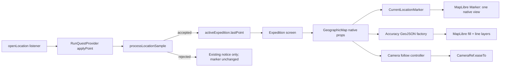

# MapLibre Animated Current-Location Marker: Technical Design

**Product:** RunQuest  
**Status:** Design for review only — **no implementation has begun**  
**Scope:** Native MapLibre current-location marker, GPS accuracy visualization, follow/recenter camera behaviour, motion/accessibility rules, and associated tests.  
**Out of scope:** Offline-region management, tile-source settings, background tracking, sensor fusion, changes to XP/tile rules, persistence-schema changes, and browser-map parity beyond safe fallback presentation.

## 1. Design decision

RunQuest will replace the current native map’s static GeoJSON position circle with a **single interactive MapLibre `Marker`** that hosts one lightweight React Native visual. A separate, low-complexity GeoJSON polygon will visualize the *geographically meaningful* horizontal GPS accuracy radius. The route and discovered atlas cells remain MapLibre style layers, not React views.

This split is deliberate. MapLibre documents `Marker` as an interactive React Native view and notes that static map content should use annotations or style layers for better performance.[1] RunQuest needs exactly one interactive live-position control, while its accuracy radius, route, and up to 80 atlas cells are static geography that MapLibre should render natively.

> **Core rule:** The marker communicates confidence; it never changes game truth. `processLocationSample` remains the sole authority for whether a reading can affect distance, territory, XP, contracts, or achievements.

| Element | Rendering strategy | Reason |
|---|---|---|
| Current player position | One MapLibre `Marker` containing one React Native `View` tree | Supports interaction, pulse, accessibility semantics, and visual identity without a marker-per-tile cost. |
| Accuracy radius | `GeoJSONSource` + `fill` and `line` layers | A latitude/longitude circle stays geographically correct when zoom changes and while the map is panned. |
| Current-point fallback | Marker core remains visible when `accuracy` is `null` | Location can be usable even if accuracy metadata is unavailable. |
| Route | Existing GeoJSON line layer | No behavioural change; keeps rendering native and bounded. |
| Atlas cells | Existing GeoJSON circle layer | No behavioural change; avoids dozens of React views. |
| Web preview | Small non-animated semantic fallback | Browser preview remains honest; the requested interactive native MapLibre experience is tested in an Android development build. |

## 2. Existing behaviour and intended delta

The current native renderer has one `GeoJSONSource` named `runquest-current-position` and renders a coral 8-pixel circle. `Camera` receives only `initialViewState`, so it does not follow later accepted readings. The active Expedition screen passes the active expedition’s `lastPoint`; the Atlas screen passes the last recorded route point. Neither call site has an explicit camera-follow or marker-presentation policy.

The change replaces only that presentation behaviour. It **does not alter** `RoutePoint`, `RunQuestState`, migration, persistence, the deterministic hex encoder, GPS anti-cheat gates, XP, achievements, daily contracts, or offline tiles.

| Concern | Current implementation | Designed implementation |
|---|---|---|
| Live position | Static coral GeoJSON point | One interactive native marker with a centre core, confidence halo, and optional pulse. |
| Accuracy | No visual treatment | Transparent, geodesic accuracy circle for accepted readings with finite accuracy metadata. |
| Camera | Initial location only | Explicit follow/free state, manual-pan disengagement, and rate-limited `easeTo` updates. |
| Reduce Motion | Map position is static; no marker policy | Marker pulse disabled; location and accuracy remain visible; camera uses a short controlled transition or an immediate recenter. |
| Map remounts | Map key is derived from initial point timestamp | Stable map instance after initial mount; position and camera update imperatively/declaratively without remounting. |
| Game logic | GPS filters are in `processLocationSample` | Unchanged. Visuals consume only the already accepted `activeExpedition.lastPoint`. |

## 3. Product behaviour

### 3.1 Location-confidence states

The marker reflects the accuracy value supplied with the accepted `RoutePoint`. The engine already rejects accuracy greater than 75 metres before that point becomes `lastPoint`, so the normal live marker has a maximum displayed radius of 75 metres. This design retains that exact rule rather than introducing a second eligibility threshold.

| State | Condition | Marker treatment | Accuracy geometry | Copy / accessibility label |
|---|---|---|---|---|
| Precise | `accuracy !== null && accuracy <= 15` | Teal core, cyan outer halo, pulse permitted | Teal translucent ring at actual radius | “Live position. GPS accuracy within 15 metres.” |
| Usable | `15 < accuracy <= 35` | Cyan core, stable halo | Cyan translucent ring at actual radius | “Live position. GPS accuracy approximately N metres.” |
| Cautious | `35 < accuracy <= 75` | Gold core, stable halo, no celebratory pulse | Gold translucent ring at actual radius | “Live position. GPS accuracy is limited to approximately N metres.” |
| Accuracy unavailable | `accuracy === null` | Coral/teal neutral core, no confidence pulse | No ring | “Live position. GPS accuracy is not available.” |
| No accepted point | `currentPoint == null` | No marker | No ring | “Awaiting a valid location.” |
| Paused session | Expedition status is `paused` | Last accepted marker remains but is visually muted | Existing ring remains at reduced opacity | “Expedition paused. Position updates are not being recorded.” |

The **Cautious** state does not imply that rewards are disabled—the current engine permits values through 75 metres. It communicates that precision is weaker. Readings above 75 metres are already rejected by engine logic, so they must not move this marker, grow the route, or award discovery. The last accepted point remains on-screen until a valid reading replaces it.

### 3.2 Marker interaction

Pressing the current-location marker performs the same operation as the explicit **Recenter** control: it puts the camera in `FOLLOWING` state and centres the map on the last accepted point. A visible, labeled Recenter button is still mandatory; an icon-only marker is not an adequate accessibility path.

The active Expedition screen gets two compact controls over the lower safe area of the map:

| Control | State | Action | Accessibility label |
|---|---|---|---|
| Follow / Recenter | `FOLLOWING` | Shows selected visual state; optional tap refreshes centre | “Following your current location.” |
| Follow / Recenter | `FREE` after a player pan, zoom, or rotate | Centres last accepted point and changes to `FOLLOWING` | “Recenter map on your current location.” |
| Accuracy status chip | Any accepted point | Displays the current accuracy band and metric accuracy when known; not a modal | “Location accuracy: approximately N metres.” |

The Atlas screen has no active follow control because it displays historical state. It may render the same marker component in **static mode**, but it will not animate or auto-centre after the initial view state.

## 4. Rendering architecture



### 4.1 New presentation-only modules

| Module | Responsibility | Exports | Data/persistence effect |
|---|---|---|---|
| `components/runquest/current-location-marker.native.tsx` | Render one marker visual and control its reduced-motion-safe pulse. | `CurrentLocationMarker` | None. |
| `components/runquest/location-accuracy.ts` | Pure geometry and display helpers: classify accuracy; build a bounded GeoJSON polygon. | `classifyLocationAccuracy`, `buildAccuracyFeature`, `formatAccuracyLabel` | None. |
| `components/runquest/geographic-map.native.tsx` | Compose the marker, accuracy layers, camera ref, follow state, and existing map layers. | Existing `GeographicMap` | None. |
| `components/runquest/geographic-map.types.ts` | Add presentation props while keeping existing data props unchanged. | `GeographicMapProps` | None. |
| `app/expedition.tsx` | Pass active/paused/reduced-motion mode and render labeled map controls. | Screen only | None. |
| `app/(tabs)/atlas.tsx` | Select static historical mode. | Screen only | None. |
| `components/runquest/geographic-map.web.tsx` | Accept new props but ignore native-only animation/follow behaviour. | Existing web fallback | None. |

No module in `lib/runquest/engine.ts`, `context.tsx`, `types.ts`, `migration.ts`, or `persistence.ts` needs to change for the marker feature. Keeping the feature presentation-only is the key mechanism that protects old saved state.

### 4.2 Proposed prop contract

The existing props remain intact. The only additions are optional visual state inputs, so any current call site remains type-safe during staged wiring.

```ts
type MapPresentationMode = "expedition" | "atlas";
type MapFollowMode = "FOLLOWING" | "FREE";

type GeographicMapProps = {
  route: RoutePoint[];
  tiles: TileRecord[];
  currentPoint?: RoutePoint | null;
  offlineRegion?: OfflineMapRegion | null;

  // New, presentation-only, all optional during migration of call sites.
  mode?: MapPresentationMode;
  expeditionStatus?: "active" | "paused";
  reduceMotion?: boolean;
  onFollowModeChange?: (mode: MapFollowMode) => void;
};
```

`MapFollowMode` is intentionally **component-local UI state**, not a persisted setting. A player’s decision to pan away from their location should reset naturally when this screen closes. It is not a game rule, a player preference, or data that belongs in a forward migration.

## 5. Accuracy geometry

### 5.1 Why a polygon, not a pixel circle

An accuracy measurement is a ground-distance radius in metres. A screen-pixel circle lies about different ground distances at different zoom levels and latitudes, so it cannot accurately represent that value. The design will generate a geodesic approximation with 24 vertices and render it as a fill plus a 1-pixel outline.

Twenty-four points is a deliberate mobile balance: smooth enough for a small overlay at zoom 15, small enough to allocate once per accepted location rather than every frame. It produces exactly one polygon, not 24 React components.

### 5.2 Pure helper algorithm

The helper receives the current point and returns an empty feature collection if location accuracy is unavailable or invalid. It clamps displayed accuracy to the maximum *already accepted* value (75 metres) and uses a small minimum visual radius of 5 metres so a 1–2 metre reading does not vanish behind the marker core.

```ts
const EARTH_RADIUS_METERS = 6_371_000;
const DISPLAY_MIN_ACCURACY_METERS = 5;
const DISPLAY_MAX_ACCEPTED_ACCURACY_METERS = 75;
const ACCURACY_SEGMENTS = 24;

function buildAccuracyFeature(point: RoutePoint): GeoJSON.FeatureCollection {
  if (point.accuracy === null || !Number.isFinite(point.accuracy) || point.accuracy < 0) {
    return EMPTY_FEATURE_COLLECTION;
  }

  const radius = Math.min(
    DISPLAY_MAX_ACCEPTED_ACCURACY_METERS,
    Math.max(DISPLAY_MIN_ACCURACY_METERS, point.accuracy),
  );

  // Calculate 24 destinations on a sphere, then close the ring.
  // Coordinates are [longitude, latitude] as required by GeoJSON/MapLibre.
  const ring = makeGeodesicRing(point.latitude, point.longitude, radius, ACCURACY_SEGMENTS);
  return featureCollection([polygon([ring], { accuracyBand: classifyLocationAccuracy(radius).band })]);
}
```

`makeGeodesicRing` uses the standard destination-point calculation with a fixed Earth radius, calls `Math.cos`/`Math.sin` only 24 times, and closes the first/last coordinate. It must not import a large geography library for this small deterministic operation. Unit tests will validate a sample at the equator, a mid-latitude point, a near-polar supported map point, null accuracy, zero accuracy, negative accuracy, and a 200 metre input.

### 5.3 Layer design

```tsx
<GeoJSONSource id="runquest-location-accuracy" data={accuracyFeature} tolerance={0}>
  <Layer
    id="runquest-location-accuracy-fill"
    type="fill"
    paint={{
      "fill-color": ["match", ["get", "accuracyBand"], "PRECISE", rq.teal, "USABLE", rq.cyan, rq.gold],
      "fill-opacity": paused ? 0.06 : 0.14,
    }}
  />
  <Layer
    id="runquest-location-accuracy-outline"
    type="line"
    paint={{
      "line-color": ["match", ["get", "accuracyBand"], "PRECISE", rq.teal, "USABLE", rq.cyan, rq.gold],
      "line-width": 1,
      "line-opacity": paused ? 0.35 : 0.65,
    }}
  />
</GeoJSONSource>
```

The accuracy geometry will be placed **below** the route and current marker but above the raster basemap, ensuring that it is visible without hiding route discovery feedback. It must use transparent colors; no full-opacity disc may conceal road labels or attribution.

## 6. Marker visual and animation design

### 6.1 Structure

`CurrentLocationMarker` contains a fixed 44 × 44 point touch target. Its visible elements are a 12-point colored core, a 22-point translucent halo, an optional 36-point pulse ring, and a 2-point white core detail. The marker anchor remains `"center"`, so the coordinate accurately marks the centre of the visual.

```tsx
<Marker
  id="runquest-current-location"
  lngLat={[point.longitude, point.latitude]}
  anchor="center"
  onPress={handleRecenter}
  accessibilityRole="button"
  accessibilityLabel={accessibilityLabel}
>
  <CurrentLocationMarker
    band={accuracyBand}
    paused={expeditionStatus === "paused"}
    reduceMotion={reduceMotion}
  />
</Marker>
```

MapLibre’s current `Marker` implementation accepts one React element child, hosts a native Android view at the map projection, and exposes `getAnimatableRef()` for Reanimated v4 compatibility.[1] This design animates an inner view, so it does not require moving the native marker view from Reanimated; changing `lngLat` is sufficient for its geographic position.

### 6.2 Motion rules

| Condition | Pulse behaviour | Marker movement | Why |
|---|---|---|---|
| Live, precise reading, Reduce Motion off | One repeating ring, scale 1.0 → 1.55 and opacity 0.34 → 0 over 900 ms | MapLibre updates marker location from the accepted `lngLat` prop | Communicates active tracking without a game-like distraction. |
| Usable reading, Reduce Motion off | One slower/subtler ring, scale 1.0 → 1.35 over 1,200 ms | Same | Confidence is present but less emphatic. |
| Cautious reading | No repeating pulse | Same | Avoids presenting weak GPS as high confidence. |
| Accuracy missing or paused | No pulse; static muted halo | Same for the last accepted position | Maintains awareness without falsely signalling current precision. |
| Reduce Motion on | All loops disabled; static state colors remain | Camera movement is limited to short ease or instant explicit recenter | Essential information remains without non-essential movement. |
| Screen unmount or state transition | `cancelAnimation` / cleanup | No pending timers or subscription | Prevents orphaned worklets or visual leaks. |

The pulse must use a **single Reanimated shared value** and worklet-driven `withRepeat(withTiming(...))`, not a JavaScript `setInterval` or multiple `Animated` instances. The component starts/restarts it only on changes to `band`, `paused`, or `reduceMotion`, and cancels the prior animation in cleanup. It will not animate the marker’s coordinate, calculate distance, or touch provider state.

## 7. Camera-follow state machine

MapLibre’s `Camera` exposes `easeTo({ center, duration, easing })` and does not require a map remount for viewport updates.[2] Map region-change events include both `animated` and `userInteraction` booleans, so the map can distinguish a player gesture from the app’s own follow movement.[3]

```mermaid
stateDiagram-v2
    [*] --> FOLLOWING: first accepted point in active expedition
    FOLLOWING --> FOLLOWING: accepted point passes coalescing guard / camera ease
    FOLLOWING --> FREE: userInteraction region change
    FREE --> FREE: accepted point updates marker and accuracy only
    FREE --> FOLLOWING: player taps Recenter or current-location marker
    FOLLOWING --> PAUSED: expedition pauses
    FREE --> PAUSED: expedition pauses
    PAUSED --> FOLLOWING: player resumes; next accepted point
    PAUSED --> [*]: finish or unmount
```



### 7.1 Follow controller rules

| Rule | Value | Rationale |
|---|---:|---|
| Default on active Expedition | `FOLLOWING` after first accepted point | The map should initially serve the live task. |
| Default on Atlas | `FREE` | Historical map is for exploration, not navigation. |
| Manual-panning detection | `onRegionWillChange` or `onRegionDidChange` where `nativeEvent.userInteraction === true` | Stops “camera fighting” the player. |
| Camera spacing | Minimum 750 ms between `easeTo` calls | Avoids launching a native camera animation for every sensor delivery. |
| Position spacing | Minimum 6 metres from last camera centre | Avoids animation jitter caused by normal GPS drift. |
| Animation | `easeTo`, duration 300 ms, `easing: "ease"` | Short enough for moving users, not cinematic. |
| First valid point | `jumpTo` or 0–200 ms `easeTo` | Avoids a long fly-in when opening the map. |
| Paused session | No automatic moves | The player controls map exploration while paused. |
| Explicit recenter | Immediate `FOLLOWING`, then `easeTo` at 250 ms | Clear, responsive recovery after manual exploration. |

The controller holds `lastCameraCenter`, `lastCameraAt`, and `followMode` in component refs/state. It does **not** create timers. Each new accepted `currentPoint` runs a pure `shouldMoveCamera` predicate. When false, no native call is made. When true, the component invokes the documented `cameraRef.current?.easeTo(...)` method.[2]

```ts
const shouldMoveCamera = ({ point, followMode, status, lastCenter, lastAt, now }) => {
  if (followMode !== "FOLLOWING" || status !== "active") return false;
  if (now - lastAt < 750) return false;
  if (!lastCenter) return true;
  return haversineMeters(lastCenter, point) >= 6;
};
```

This helper must be presentation-local or receive only a tiny distance utility; it must not call or alter `processLocationSample`. The camera should use the last accepted point, not raw location-listener input, so a rejected poor/out-of-order/implausible GPS reading cannot visibly teleport the player.

## 8. Error handling and edge cases

| Scenario | Required behaviour |
|---|---|
| Location permission denied or web preview | Existing demo capability/fallback remains. No live marker appears until the demo produces an accepted point. |
| Reading accuracy is `null` | Render neutral marker without the accuracy polygon. Do not invent a radius. |
| Reading accuracy is invalid, negative, or non-finite | Do not render an accuracy polygon. This should normally have been blocked at migration/engine boundaries. |
| Reading accuracy > 75 m | The current engine rejects it; the map keeps showing the last accepted marker and its existing ring. |
| User pans while a `easeTo` call is in progress | The first gesture-derived event sets mode to `FREE`; subsequent points do not call camera methods. |
| Route is empty but current point exists | Marker and accuracy circle render; map centres to initial current point. |
| Map native view has not initialized | Camera ref is nullable; all calls use optional chaining. No call to `setStop` occurs until the ref exists. |
| Component unmounts during an animation | Marker cancels its shared animation in cleanup. No JS interval exists. |
| Active expedition pauses | The last accepted visual remains, no camera follow; lifecycle listener cleanup is addressed separately in the approved tracking hardening milestone. |
| Offline region lacks current-point coverage | Marker and accuracy still render over the currently available map state; offline-pack coverage messaging belongs to the offline-region milestone. |

## 9. File-level implementation plan

| File | Change | Compatibility risk | Mitigation |
|---|---|---|---|
| `components/runquest/current-location-marker.native.tsx` | **New.** One marker visual, Reanimated pulse, accessibility label, cleanup. | Low | No domain imports other than a display-band type. |
| `components/runquest/location-accuracy.ts` | **New.** Pure geometry/classification helpers. | Low | Deterministic unit tests; no I/O or React state. |
| `components/runquest/geographic-map.native.tsx` | Remove current GeoJSON point, add `Marker`, accuracy layers, `Camera` ref, follow state/event handlers. | Medium | Keep route/tiles/offline source unchanged; no map remount on position update. |
| `components/runquest/geographic-map.types.ts` | Add optional presentation props. | Low | Existing call sites remain valid until explicitly wired. |
| `components/runquest/geographic-map.web.tsx` | Accept optional props and show static point/accuracy fallback only if appropriate. | Low | Preserve lazy Leaflet loading and browser-demo behaviour. |
| `app/expedition.tsx` | Pass `mode="expedition"`, active/paused status, and Reduce Motion; add a safe-area Recenter control/status chip. | Medium | Keep pause/resume/finish/demo buttons untouched and verify full flow. |
| `app/(tabs)/atlas.tsx` | Pass `mode="atlas"` and Reduce Motion; no follow control. | Low | Retain present historical view. |
| `tests/runquest.map.test.ts` | **New.** Pure geometry, accuracy band, follow predicate, and invalid input tests. | None | Tests do not need native map runtime. |
| `tests/runquest.engine.test.ts` | Optional only: add an assertion that rejected accuracy samples leave `lastPoint` unchanged. | Low | Documents existing engine contract rather than changing it. |

### Explicitly unchanged files

`lib/runquest/types.ts`, `engine.ts`, `context.tsx`, `migration.ts`, `persistence.ts`, `offline-packages.ts`, `offline-regions.ts`, state keys, tile IDs, workout records, and all package versions remain unchanged for this feature. No new native dependency, permission, Google service, background location capability, or cloud service is needed.

## 10. Test and acceptance plan

### 10.1 Deterministic tests

| Test | Assertion |
|---|---|
| Accuracy classification | 0/5/15/16/35/36/75/null/negative/non-finite values map to the correct band or no geometry. |
| Polygon integrity | 24 segments plus closing coordinate; finite longitude/latitude; radius clamped 5–75 m; empty collection for absent/invalid accuracy. |
| Follow predicate | Does not move in `FREE`/paused modes, inside 750 ms, inside 6 m, or without accepted point; moves for first/meaningful accepted point. |
| Manual interaction | A MapLibre region event with `userInteraction: true` sets `FREE`; programmatic animated region events do not. |
| Reduced motion | Pulse plan reports disabled and no loop is started. |
| GPS safety regression | A >75 m sample does not replace the previous accepted `lastPoint`; visual input therefore remains stable. |

### 10.2 Android physical-device checks

The native MapLibre marker must be tested in a development build, not only in the web preview. The validation session covers an Android 7.0/API 24-class device where available and a current Android device.

| Scenario | Pass condition |
|---|---|
| Cold start with a valid location | Marker appears once; initial camera centres without remounting the map. |
| Walk/run with 100 accepted updates | Route and marker advance; follow calls remain rate-limited; no visible camera jitter. |
| Manual pan then live updates | Camera stays where the player placed it; marker continues to update; Recenter restores following. |
| Accuracy changes through all bands | Ring colour/radius/label change correctly; no false pulse for Cautious/null readings. |
| Reduce Motion enabled | No repeating pulse; map remains readable and recenter still works. |
| Pause / resume / finish | Pause blocks automatic camera moves; marker component cleans up; no error after finish. |
| 30-minute outdoor session | No sustained memory growth, frame degradation, duplicated marker, or accumulating timers/worklets. |
| Browser preview | No crash; demo/static fallback remains usable. |

### 10.3 Required quality gates

After the approved implementation—not during this design-only phase—the exact minimum gates are:

```text
pnpm check
pnpm test
pnpm lint
```

The change is accepted only if the existing 15 deterministic regression tests remain green, new map-presentation tests pass, no saved-state migration is introduced, MapLibre uses no Google dependency, and the Android physical-device checks above are recorded.

## 11. Implementation sequence after design approval

1. Add pure accuracy geometry and follow predicate tests first.
2. Add the native marker visual in a new isolated component, including motion cleanup and accessibility labels.
3. Wire marker and accuracy layers into `geographic-map.native.tsx`; remove only the current static GeoJSON point layer.
4. Add camera ref, manual-interaction detection, and rate-limited follow/recenter behaviour.
5. Wire Expedition presentation props and controls; wire Atlas static mode.
6. Preserve web fallback and run the full quality gate.
7. Test on Android development builds, capture performance observations, checkpoint, and push only after validation.

This is a targeted enhancement rather than a map-engine rewrite. It creates no schema obligation and is reversible at the component level if a native annotation regression appears.

## References

[1]: https://maplibre.org/maplibre-react-native/docs/components/annotations/marker/ "MapLibre React Native — Marker"
[2]: https://maplibre.org/maplibre-react-native/docs/components/camera/ "MapLibre React Native — Camera"
[3]: https://github.com/maplibre/maplibre-react-native/blob/main/src/components/map/Map.tsx "MapLibre React Native — Map region change event contract"
